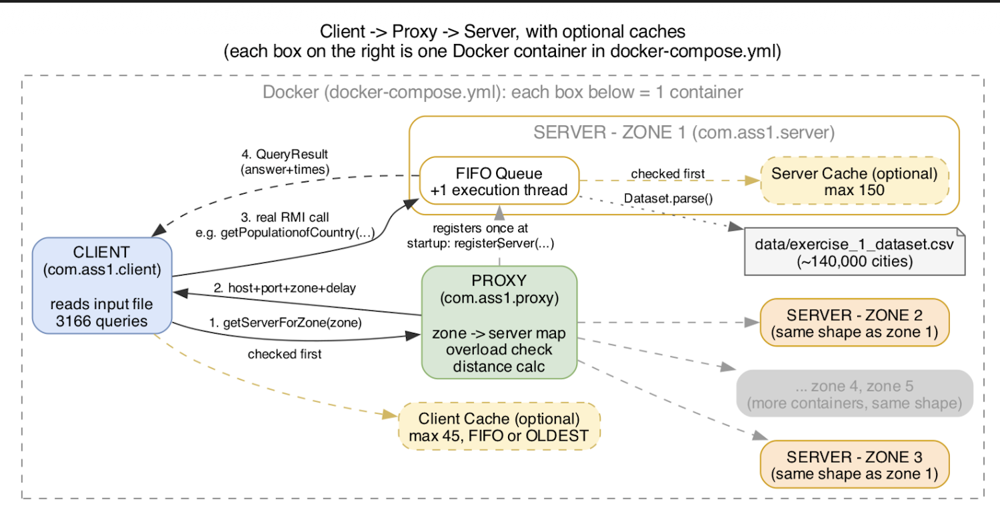

# IN5020-A1-G1-RMI

IN5020: Assignment 1 and Group 1

**The Java-RMI International Statistics Service**.

A distributed statistics service over a dataset of approximately 140,000 cities: a client sends queries through a load-balancing proxy to one of several zone servers, with optional server-side and client-side caching. Built with plain Java RMI (no external libraries), Maven and Docker.

## System design



Every box inside the dashed frame runs as its own Docker container (see `docker-compose.yml`).

- **Startup:** each zone server calls `registerServer(...)` on the proxy once, and the proxy hands out zone numbers in ascending order.
- **1-2. Ask the proxy:** for every query the client calls `getServerForZone(zone)`. The proxy keeps a zone -> server map, checks whether the server in that zone is overloaded and calculates distance to neighbour zones, then returns the chosen server's host, port, zone and simulated network delay.
- **3. Real RMI call:** the client calls the chosen server directly (e.g. `getPopulationofCountry(...)`). The server puts the request in a FIFO queue drained by a single execution thread, which answers from the dataset (`data/exercise_1_dataset.csv`, ~140,000 cities).
- **4. Result:** the server returns a `QueryResult` with the answer, the time spent waiting in the queue, the execution time and which zone served it.
- **Caches (optional, dashed yellow):** in `client_cache` mode the client checks its own cache (max 45 entries) before contacting the proxy at all. In `server_cache` mode the server checks its cache (max 150 entries) before parsing the dataset. Eviction is FIFO or OLDEST.
- Zones 2-5 are identical copies of zone 1. The client reads 3,166 queries from the input file.

See `Assignment1_Group1_Report.pdf` for the full design, build, implementation, user guide, screenshots, workload split and test results.

## Build & run

```bash
mvn clean package

# 1) Proxy
java -cp target/solution.jar com.ass1.proxy.Main

# 2)
# One or more servers args: port datasetPath cacheMode
# CacheModes are: "none", "FIFO" or "OLDEST".
# The Proxy assigns each server's zone number automatically (ascending) as it registers.
java -cp target/solution.jar com.ass1.server.Server 2000 data/exercise_1_dataset.csv none

# 3) Client args: mode evictionMethod T(ms) inputFile
#    modes are: "naive", "server_cache" or "client_cache"
java -cp target/solution.jar com.ass1.client.Client naive FIFO 50 input/exercise_1_input.txt
```

Toolchain used: **JDK 17**, **Maven 3.9**, **Docker**.

## Run everything automatically

```bash
chmod +x run_all.sh
./run_all.sh
# all 10 configs, starts 5 zone servers each run, clears output/ first

pip install matplotlib
python3 plot_graphs.py
# reads output/, writes graphs to output/graphs/
```

## Docker

One image runs every process, the command picks proxy, server or client. Compose starts the proxy and one server per zone (1-5) on a shared network, so containers reach each other by service name.

```bash
# build the shared image once
docker compose build
# Not using `up -d --build`, since it can race when 6 services share one image

# starts proxy and one server per zone (1-5)
docker compose up -d

# runs the client once, results land in ./out
docker compose run --rm client
docker compose down
```

`PROXY_HOST` tells servers and the client where the proxy is.
`SERVER_HOST` is the name a server registers with and puts in its RMI stub (`java.rmi.server.hostname`).
Compose sets it to the service name. Both default to `localhost`, so plain local runs are unchanged.

To export the built image for delivery:

```bash
docker save in5020-a1-g1 | gzip > in5020-a1-g1-image.tar.gz
```

To load the exported image on another machine (instead of building it locally):

```bash
docker load -i in5020-a1-g1-image.tar.gz
docker compose up -d
```

## About the output file names

The assignment text names three output files: `naive_server.txt`, `server_cache.txt` and `client_cache.txt`. We test with both T=50 and T=20, and the caching modes with both FIFO and OLDEST eviction, which is 10 combinations, not 3. Three fixed filenames cannot hold 10 different runs without overwriting each other, so we deliberately produce one file per combination instead, with descriptive names (e.g.: `naive_T50.txt`, `server_cache_FIFO_T20.txt`, `client_cache_OLDEST_T50.txt`). All 10 files are in the `/output/` folder.

## Members

Philip Elias Fleischer: philipef@uio.no

Anwar Ahmed Hersi: anwarahe@uio.no

Håkon Gulliksrud: haakgull@uio.no

Mateus Boergeson: matande@uio.no

## Workload split

| Member | Responsibility |
|---|---|
| **Philip** | Client and Proxy server |
| **Anwar** | Processing server, including queue technique |
| **Håkon** | Cache technique |
| **Mateus** | Docker/Container |
